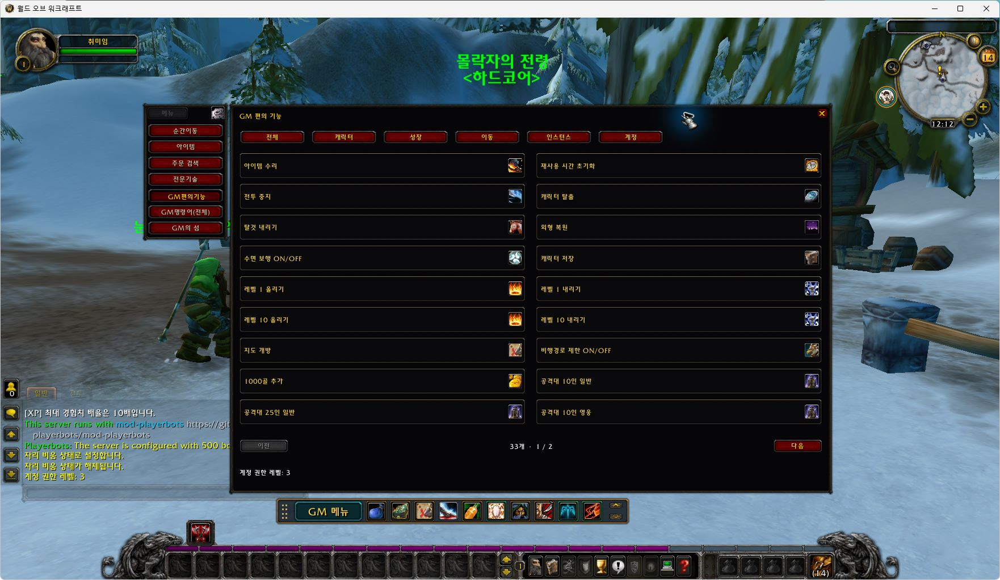
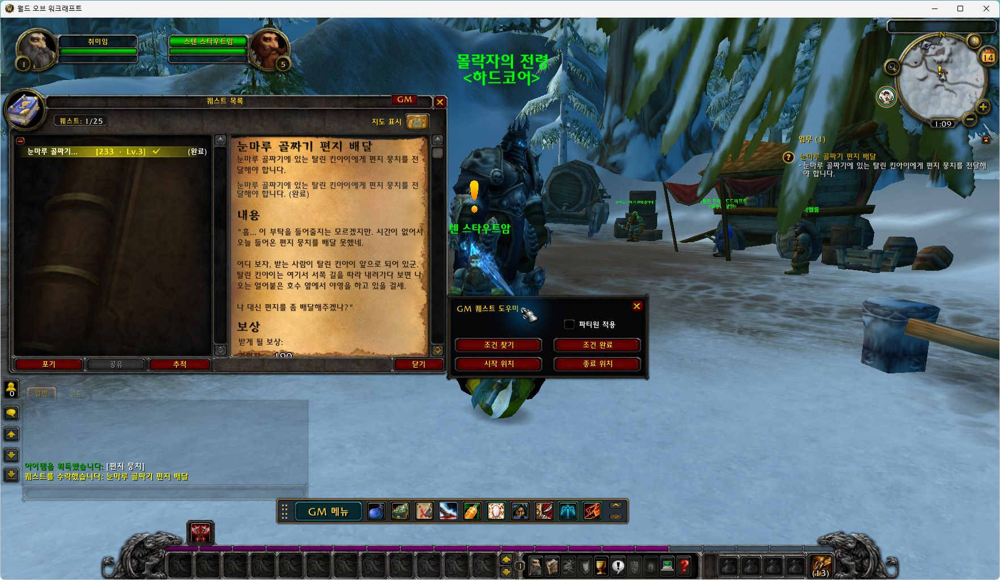
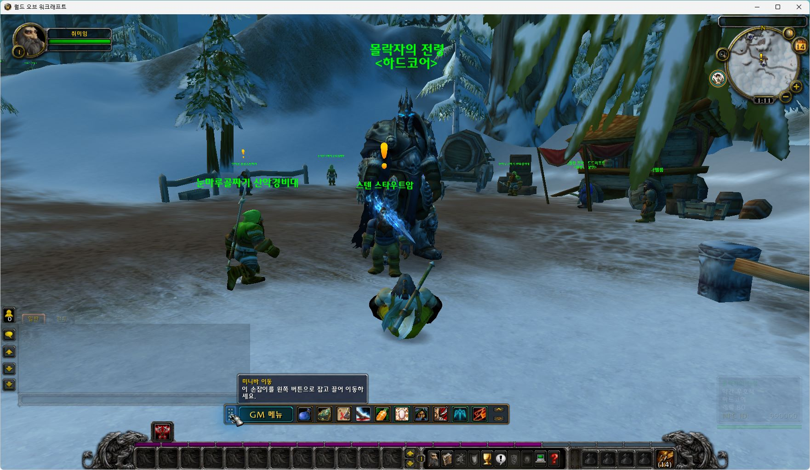
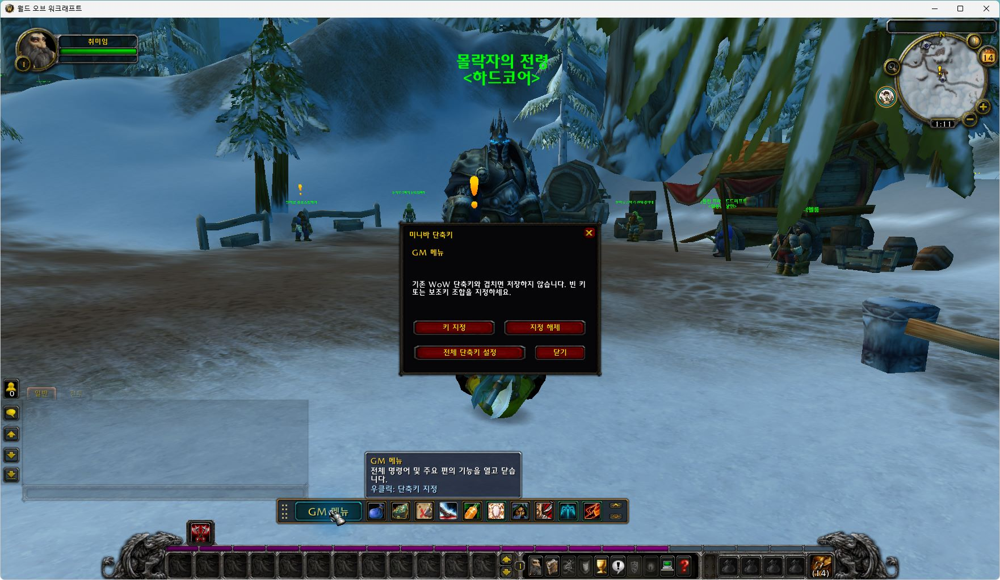
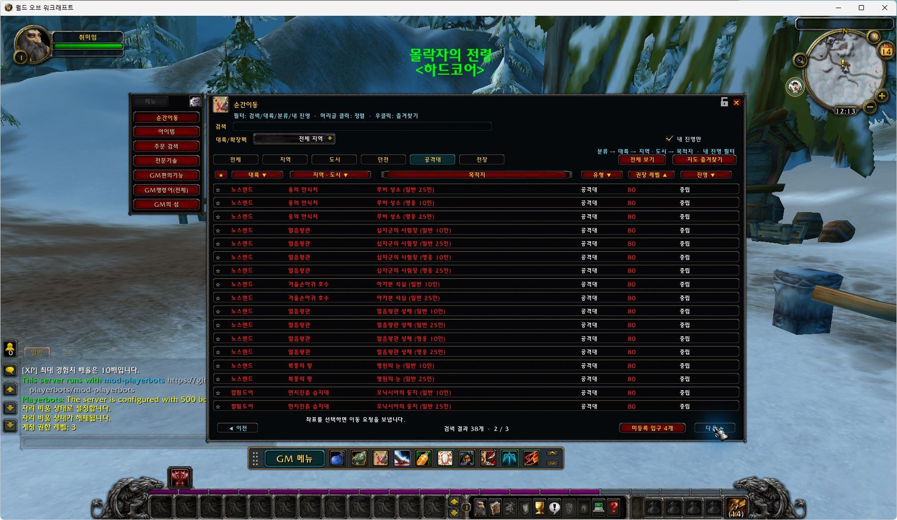
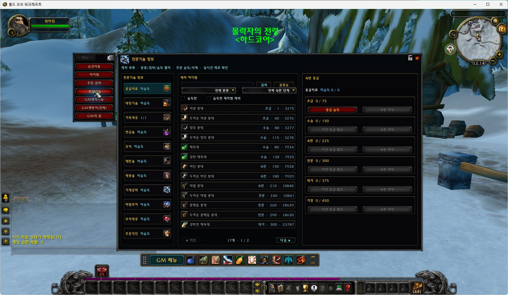
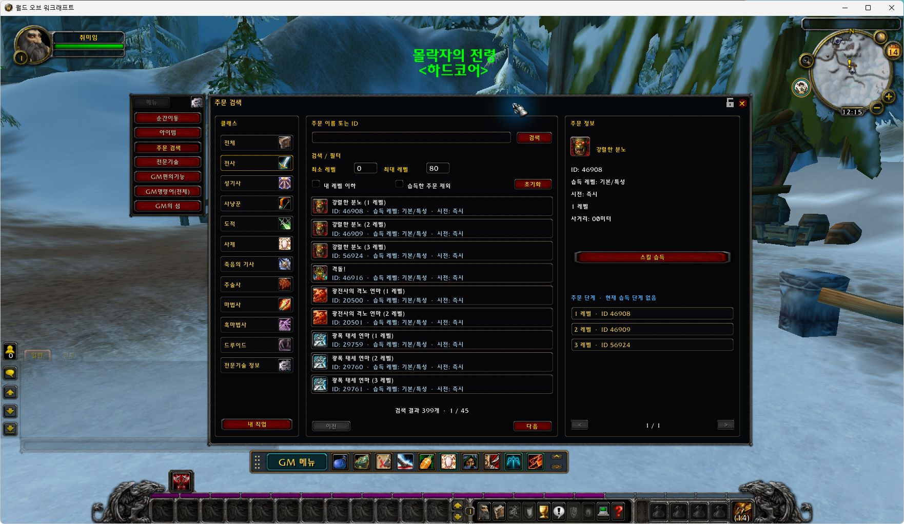
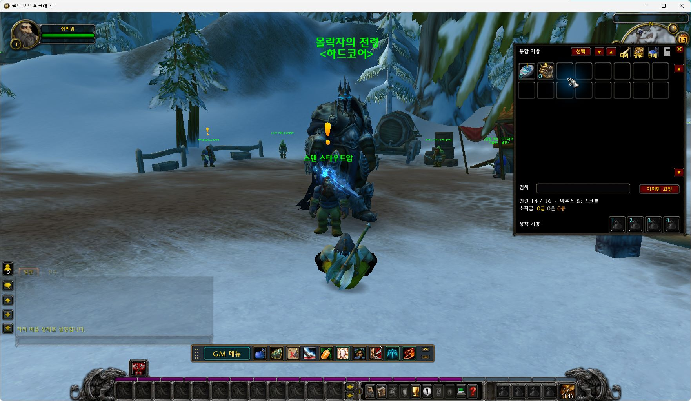

# GM MINI BAR — Wrath of the Lich King · AzerothCore

**[English](README.md) | [한국어](README.ko.md)**

**GM tools for WoW 3.3.5a (12340) / AzerothCore**, with a WoW-style interface for private-server administration and testing: search, teleportation, quests and character utilities. Created by **취미연구가** · Current release: **v1.0.0**.

The addon supports Korean, English, Simplified Chinese, Traditional Chinese and Russian UI, plus automatic client-language selection.

**[Download installation ZIP](https://github.com/hilch1981-prog/azerothcore-gm-addon/releases/download/v1.0.0/GMminibar_AzerothCore_3.3.5a_v1.0.0.zip)** · [Release notes](https://github.com/hilch1981-prog/azerothcore-gm-addon/releases/tag/v1.0.0) · [Report an issue](https://github.com/hilch1981-prog/azerothcore-gm-addon/issues)

[](https://github.com/hilch1981-prog/azerothcore-gm-addon/actions/workflows/validate.yml)

Screenshots were captured in **WoW 3.3.5a / WOW Legends Repack 1.5.3**.



*GM utilities: two-column icon buttons and categories*

## Installation and launch

1. Download the installation ZIP above for **WoW 3.3.5a (12340)** and close the game.
2. Extract the single **GMminibar** folder into your game’s `Interface/AddOns` directory.
3. Confirm the final path is `Interface/AddOns/GMminibar/GMminibar.toc`.
4. Enable the matching **GM MINI BAR** entry in the AddOns list and log in to a character.
5. Open the addon with **GM Menu** on the minibar or `/aaac`.

GitHub’s **Source code (zip / tar.gz)** downloads are for development. Use the **installation ZIP** for normal installation. Fonts, Data and other internal subfolders are resources belonging to the same addon.

**No additional MPQ, DLL or SQL installation is required.** This package does not include full-game translations, a server or a game client. Server GM permissions are required to execute GM commands.

Disable overlapping GM addons if they conflict. Keep your `WTF` folder to preserve saved settings.

## Languages and switching

Use **English / 한국어** at the top to switch this guide. In game, choose a UI language using the **language buttons in the gear settings panel**. Changing the language there reloads the UI.

| Button | Locale | Language |
|---|---|---|
| AUTO | auto | Follow the client language |
| KO | koKR | 한국어 / Korean |
| EN | enUS | 영어 / English |
| CN | zhCN | 중국어 간체 / 简体中文 |
| TW | zhTW | 중국어 번체 / 繁體中文 |
| RU | ruRU | 러시아어 / Русский |

You can also select a language by command:

```text
/aaac locale enUS
/aaac locale koKR
/aaac locale auto
```

Automatic mode falls back to English for unsupported client locales. Untranslated entries may remain in English or in their original text. Item and spell names and server messages also depend on client/server data; selecting an addon UI language does not translate the whole game.

## Features

| Feature | What it does |
|---|---|
| GM menu and utilities | Categorized icon buttons in two columns: level ±1/±10, repair, recovery/resurrection, stop combat, dismount, restore appearance, water walking, reveal maps, maximize skills, summon and appear. |
| Item search | Find items by name or ID, inspect their details and grant items. |
| Spell search | View spell details, ranks and learned status, filter results and learn spells. |
| Professions | Browse recipes and training tiers. Learn earlier tiers before advancing; training and maximum-skill buttons update with learned status. |
| Teleportation | Browse by continent, region/city, destination and level, with level sorting and favorites. |
| Quest helper | Find objectives, complete requirements, visit start/end locations and apply supported actions to party members beside the native quest log. |
| Unified bags | Use and move items, search, sort and pin them, and access four equipped-bag slots to add or replace bags while the window is open. |

**Click behavior in the GM utilities window:** Supported actions apply to yourself on left-click and to the selected player on right-click. If no suitable player is selected, enter a character name. Follow the hints for self-only actions and actions requiring a selected target.

Enable **Unified bags** in the gear settings, then use the bag key **B**. The bag-shaped minibar slot opens the **bank**.

## Teleport destinations

| Category | Arrival point |
|---|---|
| Inns and flight paths | Innkeeper or flight-master NPC location |
| Dungeons and raids | A landing point beside the meeting stone or the outside portal entrance |
| Battlegrounds | The outside battleground entrance |

Supported player counts and Normal/Heroic difficulties appear as separate entries. For example, Onyxia’s Lair has its supported 10-player and 25-player entries. Each instance only lists its own supported modes.

Landing adjustments are included for reported dungeon and battleground entrances. **Azjol-Nerub and Ahn’kahet share the cave approach beside their meeting stone.** See the validation section for the environments checked and remaining runtime tests.

## Using the quest helper

Open the native quest log with the minibar’s **book icon** or **L**, then select an active quest.

| Button | Action |
|---|---|
| Find objectives | Go to an objective location available in the data. Repeated clicks cycle through multiple objectives. |
| Complete requirements | Ask the server to complete the selected quest’s requirements. Turn in the quest and collect rewards separately. |
| Start location | Travel to the quest-giver location. |
| End location | Travel to the quest turn-in location. |



*Quest helper beside the native quest log*

### Apply to party

The default applies actions only to yourself. When enabled, completion also targets **connected party members who have the same quest**. For movement, the addon **confirms your arrival first, then summons party members to the same location**. If arrival cannot be confirmed, it stops the party move.

Checking the box does not execute an action. Quest selection, location data and server GM, instance-entry and summon requirements still apply.

## Minibar slots

Slots are listed from left to right. There are **11 function slots including GM Menu**, plus a drag handle and ▲/▼ size controls.

| Order | Slot | Action |
|---|---|---|
| 1 | GM Menu | Open or close the main GM window. |
| 2 | Bank | Open the bank. |
| 3 | Quest helper | Open the native quest log and helper. |
| 4 | Teleports | Open the destination browser. |
| 5 | Resurrection | Resurrect yourself when dead. While alive, use the selected player; fall back to yourself when no player is selected. |
| 6 | GM mode | Toggle GM mode. |
| 7 | God mode | Toggle invulnerability. |
| 8 | Stealth | Toggle ordinary stealth. Attacking or combat can break the effect. |
| 9 | Kill target | Kill the selected target immediately. Check your target before using it. |
| 10 | Flight | Toggle GM flight. |
| 11 | Movement speed | Switch between normal and 3× movement speed. |



*Minibar slots and the drag-handle tooltip*

**Position and size:** Drag the left handle with the left mouse button. Use the rightmost ▲/▼ controls to enlarge or shrink the minibar in 5% steps.

### Assigning hotkeys

**Left-click executes a minibar function; right-click opens its key binding dialog.** Choose Assign key, then press a key or a Ctrl/Alt/Shift combination. Clear binding removes it; All key bindings opens the full list. Conflicting existing WoW bindings are not overwritten.

**The utilities window’s right-click target action differs from the minibar’s right-click hotkey action.** For functions such as stealth and movement speed that require a self target, clear another target or select yourself first.



*Minibar right-click key binding dialog*

## More screenshots

Screenshots were captured in **WoW 3.3.5a / WOW Legends Repack 1.5.3**.

<details>
<summary>Expand teleport, profession, spell and bag screenshots</summary>



*Teleport browser: raid size and difficulty variants*



*Professions: recipes and sequential training tiers*



*Spell search: spell details and ranks*



*Unified bags: search, sorting, pinning and four equipped-bag slots*


*Quest helper: Apply to party tooltip*

</details>

## Validation status

**Eight mounted-departure and successful-landing checks** were completed on WOW Legends Repack 1.5.3: Scarlet Monastery, Blackfathom Deeps, Uldaman, Maraudon, Azjol-Nerub, Ahn’kahet and both faction entrances to Warsong Gulch. ASP1.5 itself was not tested.

Automated checks and actual game tests are reported separately. Results can vary with the server core, repack, database and permissions. This is not an exhaustive test of every environment, command or destination. See the [validation notes (Korean)](docs/VALIDATION_KO.md).

## Support and updates

Please include the following in [GitHub Issues](https://github.com/hilch1981-prog/azerothcore-gm-addon/issues) or [Discord](https://discord.gg/FqJkYz77Y):

- Game and addon versions
- Server core/repack name
- The action and steps leading to the problem
- Error text or screenshots
- For teleports: destination, difficulty and whether you were mounted

[Korean release post and user guide](https://cafe.naver.com/ca-fe/cafes/14511966/articles/52191)

## Other game versions

| Game | Repository |
|---|---|
| Wrath of the Lich King · AzerothCore | [azerothcore-gm-addon](https://github.com/hilch1981-prog/azerothcore-gm-addon) |
| Mists of Pandaria · SkyFire | [mop-gm-addon](https://github.com/hilch1981-prog/mop-gm-addon) |
| Turtle WoW · Tortoise | [turtle-gm-addon](https://github.com/hilch1981-prog/turtle-gm-addon) |

All three editions use the same installation folder name. Install only the matching ZIP in each game client. UI conventions are shared, while code, server commands, data and validation remain version-specific.

## Development and credits

Addon source: `GMminibar/` · Validation: `scripts/validate.py` · Installation ZIP builder: `scripts/package.py`. See [development notes (Korean)](docs/DEVELOPMENT_KO.md), [screenshot provenance](docs/SCREENSHOTS.md) and [third-party notices](THIRD_PARTY_NOTICES.md).

**[English](README.md) | [한국어](README.ko.md)**
